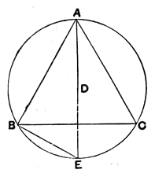

   Let $ABC$ be a circle,
and let the equilateral triangle $ABC$ be inscribed in it;
I say that the square on one side of
the triangle $ABC$ is triple of the square
on the radius of the circle.
   For let the centre $D$ of the circle
$ABC$ be taken,
let $AD$ be joined and carried through
to $E$,
and let $BE$ be joined.
   Then, since the triangle $ABC$ is
equilateral,
therefore the circumference $BEC$ is a third part of the circum-
ference of the circle $ABC$.
   Therefore the circumference $BE$ is a sixth part of the
circumference of the circle;
therefore the straight line $BE$ belongs to a hexagon;
therefore it is equal to the radius $DE$. [iv. 15, Por.]
   And, since $AE$ is double of $DE$,
the square on $AE$ is quadruple of the square on $ED$, that is,
of the square on $BE$.
   But the square on $AE$ is equal to the squares on $AB$, $BE$; [iii. 31, i. 47]
therefore the squares on $AB$, $BE$ are quadruple of the square
on $BE$.
   Therefore, *separando*, the square on $AB$ is triple of the
square on $BE$.
   But $BE$ is equal to $DE$;
therefore the square on $AB$ is triple of the square on $DE$.
   Therefore the square on the side of the triangle is triple
of the square on the radius.

Q. E. D.

---

### PROPOSITION 13.

   *To construct a pyramid, to comprehend it in a given sphere,
and to prove that the square on the diameter of the sphere is
one and a half times the square on the side of the pyramid.*
