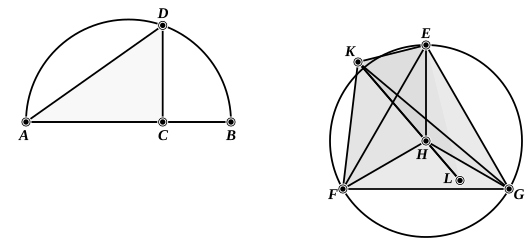

   Let the diameter $AB$ of the given sphere be set out,
and let it be cut at the point $C$ so that $AC$ is double of $CB$;
let the semicircle $ADB$ be described on $AB$,
let $CD$ be drawn from the point $C$ at right angles to $AB$,
and let $DA$ be joined;
let the circle $EFG$ which has its radius equal to $DC$ be
set out,
let the equilateral triangle ">$EFG$ be inscribed in the circle $EFG$, [iv. 2]
let the centre of the circle, the point $H$, be taken, [iii. 1]
let $EH$, $HF$, $HG$ be joined;
from the point $H$ let $HK$ be set up at right angles to the plane
of the circle $EFG$, [xi. 12]
let $HK$ equal to the straight line $AC$ be cut off from $HK$,
and let $KE$, $KF$, $KG$ be joined.

   Now, since $KH$ is at right angles to the plane of the
circle $EFG$,
therefore it will also make right angles with all the straight
lines which meet it and are in the plane of the circle $EFG$. [xi. Def. 3]
   But each of the straight lines $HE$, $HF$, $HG$ meets it:
therefore $HK$ is at right angles to each of the straight lines
$HE$, $HF$, $HG$.
   And, since $AC$ is equal to $HK$, and $CD$ to $HE$,
and they contain right angles,
therefore the base $DA$ is equal to the base $KE$. [i. 4]
