   If then, $KL$ remaining fixed, the semicircle be carried round
and restored to the same position from which it began to be
moved, it will also pass through the points $F$, $G$,
since, if $FL$, $LG$ be joined, the angles at $F$, $G$ similarly become
right angles;
and the pyramid will be comprehended in the given sphere.
   For $KL$, the diameter of the sphere, is equal to the
diameter $AB$ of the given sphere, inasmuch as $KH$ was
made equal to $AC$, and $HL$ to $CB$.
   I say next that the square on the diameter of the sphere
is one and a half times the square on the side of the
pyramid.
   For, since $AC$ is double of $CB$,
therefore $AB$ is triple of $BC$;
and, *convertendo*, $BA$ is one and a half times $AC$.
   But, as $BA$ is to $AC$, so is the square on $BA$ to the square
on $AD$.
   Therefore the square on $BA$ is also one and a half times
the square on $AD$.
   And $BA$ is the diameter of the given sphere, and $AD$ is
equal to the side of the pyramid.
   Therefore the square on the diameter of the sphere is
one and a half times the square on the side of the pyramid.

Q. E. D.

---

### LEMMA.

   It is to be proved that, as $AB$ is to $BC$, so is the square
on $AD$ to the square on $DC$.
   For let the figure of the semi-
circle be set out,
let $DB$ be joined,
let the square ">$EC$ be described
on $AC$,
and let the parallelogram ">$FB$ be
completed.
   Since then, because the tri-
angle ">$DAB$ is equiangular with
the triangle ">$DAC$,
as $BA$ is to $AD$, so is $DA$ to $AC$, [vi. 8, vi. 4]

