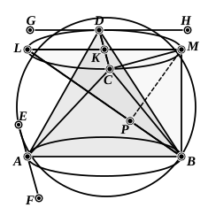

analysis and synthesis. The following is a reproduction of his solution of 
this case.

*Analysis.*

Suppose the problem solved, $A$, $B$, $C$, $D$ being the angular points of the 
required pyramid.

Through $A$ draw $EF$ parallel to $CD$; this will make equal angles with 
$AC$, $AD$; and, since $AB$ does so too, $EF$ 
is perpendicular to $AB$ [Pappus has a lemma 
for this, p. 140, 12—24], and is therefore a 
tangent to the sphere (for $EF$ is parallel to 
$CD$, the base of the triangle ">$ACD$, and 
therefore touches the circle circumscribing 
it, while it also touches the circular section 
$AB$ made by the plane passing through $AB$ 
and $EF$ perpendicular to it).

Similarly $GH$ drawn through $D$ parallel 
to $AB$ touches the sphere.

And the plane through $GH$, $CD$ makes 
a circular section equal and parallel to $AB$.

Through the centre $K$ of that circular 
section, and in the plane of the section, draw $LM$ perpendicular to $CD$ and 
therefore parallel to $AB$. Join $BL$, $BM$.

$BM$ is then perpendicular to $AB$, $LM$, and $LB$ is a diameter of the sphere. 
Join $MC$.

Then $LM$$^2 = 2$$MC$$^2$, 
and $BC$ $= $ $AB$ $= $ $LM$, 
so that $BC$$^2 = 2$$MC$$^2$.

And $BM$, being perpendicular to the plane of the circle $LM$, is perpen- 
dicular to $CM$, 
whence $BC$$^2 = $ $BM$$^2 + $ $MC$$^2$, 
so that $BM$ $= $ $MC$. 
But $BC$ $= $ $LM$; 
therefore $LM$$^2 = 2$$BM$$^2$.

And, since the angle $LMB$ is right, 
$BL$$^2 = $ $LM$$^2 + $ $MB$$^2 = \frac{3}{2}$$LM$$^2$.

*Synthesis.*

Draw two parallel circular sections of the sphere with diameter $d'$, 
such that
$$d'^2 = \frac{2}{3}d^2,$$
where $d$ is the diameter of the sphere.

[This is easily done by dividing $BL$, any diameter of the sphere, at $P$, so 
that $LP$ $= 2$$PB$, and then drawing $PM$ at right angles to $LB$ meeting the 
great circle $LMB$ of the sphere in $M$. Then $LM$$^2 : $ $LB$$^2 = $ $LP$ $:$ $LB$ $= 2 : 3$.]

Draw sections through $M$, $B$ perpendicular to $MB$, and in these sections 
respectively draw the parallel diameters $LM$, $AB$.

Lastly, in the section $LM$ draw $CD$ through the centre $K$ perpendicular 
to $LM$.

">$ABCD$ is then the required regular pyramid or tetrahedron.
