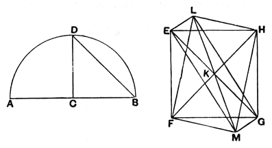

### PROPOSITION 14.

*To construct an octahedron and comprehend it in a sphere, as in the preceding case; and to prove that the square on the diameter of the sphere is double of the square on the side of the octahedron.*

Let the diameter *AB* of the given sphere be set out, and let it be bisected at *C*;
let the semicircle *ADB* be described on *AB*,
let *CD* be drawn from *C* at right angles to *AB*,
let *DB* be joined;
let the square *EFGH*, having each of its sides equal to *DB*, be set out,
let *HF*, *EG* be joined,
from the point *K* let the straight line *KL* be set up at right angles to the plane of the square *EFGH* [XI. 12], and let it be carried through to the other side of the plane, as *KM*;
from the straight lines *KL*, *KM* let *KL*, *KM* be respectively cut off equal to one of the straight lines *EK*, *FK*, *GK*, *HK*,
and let *LE*, *LF*, *LG*, *LH*, *ME*, *MF*, *MG*, *MH* be joined.

Then, since *KE* is equal to *KH*,
and the angle *EKH* is right,
therefore the square on *HE* is double of the square on *EK*.
[I. 47]

Again, since *LK* is equal to *KE*,
and the angle *LKE* is right,
therefore the square on *EL* is double of the square on *EK*.
[id.]
