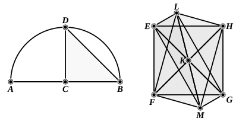

### PROPOSITION 14.

To construct an octahedron and comprehend it in a sphere, 
as in the preceding case; and to prove that the square on the 
diameter of the sphere is double of the square on the side of the 
octahedron.

Let the diameter $AB$ of the given sphere be set out, 
and let it be bisected at $C$; 
let the semicircle $ADB$ be described on $AB$, 
let $CD$ be drawn from $C$ at right angles to $AB$, 
let $DB$ be joined; 
let the square ">$EFGH$, having each of its sides equal to $DB$, 
be set out, 
let $HF$, $EG$ be joined, 
from the point $K$ let the straight line $KL$ be set up at right 
angles to the plane of the square ">$EFGH$ [XI. 12], and let it be 
carried through to the other side of the plane, as $KM$; 
from the straight lines $KL$, $KM$ let $KL$, $KM$ be respectively 
cut off equal to one of the straight lines $EK$, $FK$, $GK$, $HK$, 
and let $LE$, $LF$, $LG$, $LH$, $ME$, $MF$, $MG$, $MH$ be joined.

Then, since $KE$ is equal to $KH$, 
and the angle $EKH$ is right, 
therefore the square on $HE$ is double of the square on $EK$. 
[I. 47]

Again, since $LK$ is equal to $KE$, 
and the angle $LKE$ is right, 
therefore the square on $EL$ is double of the square on $EK$. 
[id.]
