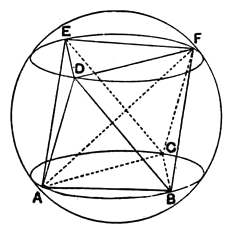

(4)
$$\begin{aligned}
\text{\it AB}^2 &= 2\text{\it BD}^2 \\
&= 2\text{\it EF}^2.
\end{aligned}$$

If $r$ be the radius of the circumscribed sphere,
$$\text{(edge of octahedron)} = \sqrt{2}\cdot r.$$

#### Pappus' method.

Pappus (III. pp. 148—150) finds the two equal and parallel sections of the sphere which circumscribe two opposite faces of the octahedron thus.

*Analysis.*

Suppose the octahedron inscribed, *A*, *B*, *C*; *D*, *E*, *F* being the vertices.

Through *ABC*, *DEF* describe planes making the circular sections *ABC*, *DEF*.

Since the straight lines *DA*, *DB*, *DE*, *DF* are equal, the points *A*, *E*, *F*, *B* lie on a circle of which *D* is the pole.

Again, since *AB*, *BF*, *FE*, *EA* are equal, *ABFE* is a square inscribed in the said circle, and *AB*, *EF* are parallel.

Similarly *DE* is parallel to *BC*, and *DF* to *AC*.

Therefore the circles through *D*, *E*, *F* and *A*, *B*, *C* are parallel; and they are also equal because the equilateral triangles inscribed in them are equal.

Now, *ABC*, *DEF* being equal and parallel circular sections, and *AB*, *EF* equal and parallel chords "not on the same side of the centres,"
*AF* is a diameter of the sphere.
[Pappus has a lemma for this, pp. 136—138].

And $\text{\it AE} = \text{\it EF}$, so that $\text{\it AF}^2 = 2\text{\it FE}^2$.

But, if $d'$ be the diameter of the circle *DEF*,
$$d'^2 = \frac{4}{3}\text{\it EF}^2. \qquad \text{[cf. XIII. 12]}$$

Therefore, if $d$ be the diameter of the sphere,
$$d^2 : d'^2 = 3 : 2.$$

Now $d$ is given, and therefore $d'$ is given; hence the circles *DEF*, *ABC* are given.

*Synthesis.*

Draw two equal and parallel circular sections with diameter $d'$, such that
$$d^2 = \frac{3}{2}d'^2,$$
where $d$ is the diameter of the sphere.

Inscribe an equilateral triangle *ABC* in either circle (*ABC*).

In the other circle draw *EF* equal and parallel to *AB* but on the opposite side of the centre, and complete the inscribed equilateral triangle *DEF*.

*ABCDEF* is the octahedron required.

It will be observed that, whereas in the problem of XIII. 13 Euclid first finds the circle circumscribing a face and Pappus first finds an edge, in this problem Euclid finds the edge first and Pappus the circle circumscribing a face.
