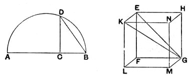

# PROPOSITION 15.

*To construct a cube and comprehend it in a sphere, like the pyramid; and to prove that the square on the diameter of the sphere is triple of the square on the side of the cube.*

Let the diameter *AB* of the given sphere be set out,
and let it be cut at *C* so that *AC* is double of *CB*;
let the semicircle *ADB* be described on *AB*,
let *CD* be drawn from *C* at right angles to *AB*,
and let *DB* be joined;
let the square *EFGH* having its side equal to *DB* be set out,
from *E*, *F*, *G*, *H* let *EK*, *FL*, *GM*, *HN* be drawn at right angles to the plane of the square *EFGH*,
from *EK*, *FL*, *GM*, *HN* let *EK*, *FL*, *GM*, *HN* respectively be cut off equal to one of the straight lines *EF*, *FG*, *GH*, *HE*,
and let *KL*, *LM*, *MN*, *NK* be joined;
therefore the cube *FN* has been constructed which is contained by six equal squares.

It is then required to comprehend it in the given sphere, and to prove that the square on the diameter of the sphere is triple of the square on the side of the cube.

For let *KG*, *EG* be joined.

Then, since the angle *KEG* is right, because *KE* is also at right angles to the plane *EG* and of course to the straight line *EG* also, [XI. Def. 3]
therefore the semicircle described on *KG* will also pass through the point *E*.

Again, since *GF* is at right angles to each of the straight lines *FL*, *FE*,
*GF* is also at right angles to the plane *FK*;
hence also, if we join *FK*, *GF* will be at right angles to *FK*;
