### PROPOSITION 15.

To construct a cube and comprehend it in a sphere, like the 
pyramid; and to prove that the square on the diameter of the 
sphere is triple of the square on the side of the cube.

Let the diameter $AB$ of the given sphere be set out, 
and let it be cut at $C$ so that $AC$ is double of $CB$; 
let the semicircle $ADB$ be described on $AB$, 
let $CD$ be drawn from $C$ at right angles to $AB$, 
and let $DB$ be joined; 
let the square ">$EFGH$ having its side equal to $DB$ be set out, 
from $E$, $F$, $G$, $H$ let $EK$, $FL$, $GM$, $HN$ be drawn at right 
angles to the plane of the square ">$EFGH$, 
from $EK$, $FL$, $GM$, $HN$ let $EK$, $FL$, $GM$, $HN$ respectively 
be cut off equal to one of the straight lines $EF$, $FG$, 
$GH$, $HE$, 
and let $KL$, $LM$, $MN$, $NK$ be joined; 
therefore the cube ">$FN$ has been constructed which is contained 
by six equal squares.

It is then required to comprehend it in the given sphere, 
and to prove that the square on the diameter of the sphere is 
triple of the square on the side of the cube.

For let $KG$, $EG$ be joined.

Then, since the angle $KEG$ is right, because $KE$ is also 
at right angles to the plane ">$EG$ and of course to the straight 
line $EG$ also, [XI. Def. 3] 
therefore the semicircle described on $KG$ will also pass through 
the point $E$.

Again, since $GF$ is at right angles to each of the straight 
lines $FL$, $FE$, 
$GF$ is also at right angles to the plane ">$FK$; 
hence also, if we join $FK$, $GF$ will be at right angles to $FK$;
