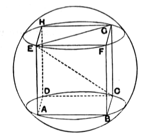

Thus, *KEG* being a right angle, *E* lies on a semicircle with diameter *KG*.
The same thing is proved in the same way of the other vertices *F*, *H*, *L*, *M*, *N*.
Thus the cube is inscribed in the sphere of which *KG* is a diameter.

(2)
$$KG^2 = KE^2 + EG^2$$
$$= KE^2 + 2EF^2$$
$$= 3EK^2.$$
Also
$$AB = 3BC,$$
while
$$AB : BC = AB^2 : AB \cdot BC$$
$$= AB^2 : BD^2;$$
therefore
$$AB^2 = 3BD^2.$$
But
$$BD = EK;$$
therefore
$$KG = AB.$$

(3)
$$AB^2 = 3BD^2$$
$$= 3KE^2.$$
If $r$ be the radius of the circumscribed sphere,
$$\text{(edge of cube)} = \frac{2}{\sqrt{3}} \cdot r = \frac{2}{3}\sqrt{3} \cdot r.$$

**Pappus' solution.**

In this case too Pappus (III. pp. 144—148) gives the full analysis and synthesis.

*Analysis.*

Suppose the problem solved, and let the vertices of the cube be *A*, *B*, *C*, *D*, *E*, *F*, *G*, *H*.
Draw planes through *A*, *B*, *C*, *D* and *E*, *F*, *G*, *H* respectively; these will produce parallel circular sections, which are also equal since the inscribed squares are equal.
And *CE* will be a diameter of the sphere.
Join *EG*.
Now, since $EG^2 = 2EH^2 = 2GC^2$, and the angle *CGE* is right,
$$CE^2 = GC^2 + EG^2 = \frac{3}{2}EG^2.$$
But $CE^2$ is given;
therefore $EG^2$ is given, so that the circles *EFGH*, *ABCD*, and the squares inscribed in them, are given.

*Synthesis.*

Draw two parallel circular sections with equal diameters $d'$, such that
$$d^2 = \frac{3}{2}d'^2,$$
where $d$ is the diameter of the given sphere.
Inscribe a square in one of the circles, as *ABCD*.
In the other circle draw *FG* equal and parallel to *BC*, and complete the square on *FG* inscribed in the circle *EFGH*.
The eight vertices of the required cube are thus determined.
