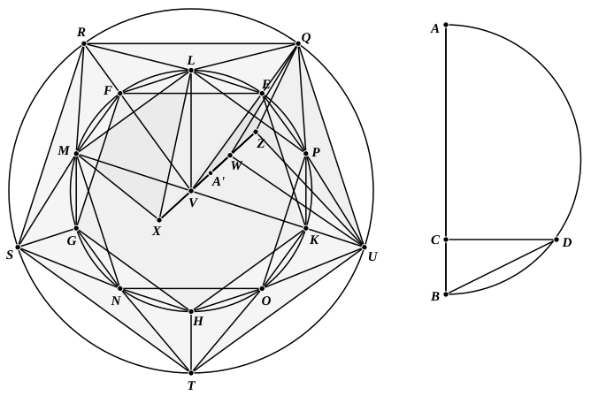

### PROPOSITION 16.

To construct an icosahedron and comprehend it in a sphere, 
like the aforesaid figures; and to prove that the side of the 
icosahedron is the irrational straight line called minor.

Let the diameter $AB$ of the given sphere be set out, 
and let it be cut at $C$ so that $AC$ is quadruple of $CB$, 
let the semicircle $ADB$ be described on $AB$, 
let the straight line $CD$ be drawn from $C$ at right angles 
to $AB$, 
and let $DB$ be joined;

let the circle $EFGHK$ be set out and let its radius be equal 
to $DB$, 
let the equilateral and equiangular pentagon ">$EFGHK$ be 
inscribed in the circle $EFGHK$, 
let the circumferences $EF$, $FG$, $GH$, $HK$, $KE$ be bisected at 
the points $L$, $M$, $N$, $O$, $P$, 
and let $LM$, $MN$, $NO$, $OP$, $PL$, $EP$ be joined.
