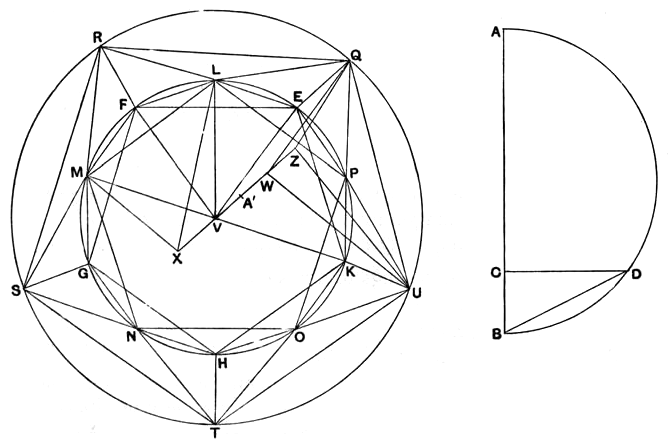

# PROPOSITION 16.

*To construct an icosahedron and comprehend it in a sphere, like the aforesaid figures; and to prove that the side of the icosahedron is the irrational straight line called minor.*

Let the diameter *AB* of the given sphere be set out,
and let it be cut at *C* so that *AC* is quadruple of *CB*,
let the semicircle *ADB* be described on *AB*,
let the straight line *CD* be drawn from *C* at right angles to *AB*,
and let *DB* be joined;

let the circle *EFGHK* be set out and let its radius be equal to *DB*,
let the equilateral and equiangular pentagon *EFGHK* be inscribed in the circle *EFGHK*,
let the circumferences *EF*, *FG*, *GH*, *HK*, *KE* be bisected at the points *L*, *M*, *N*, *O*, *P*,
and let *LM*, *MN*, *NO*, *OP*, *PL*, *EP* be joined.
