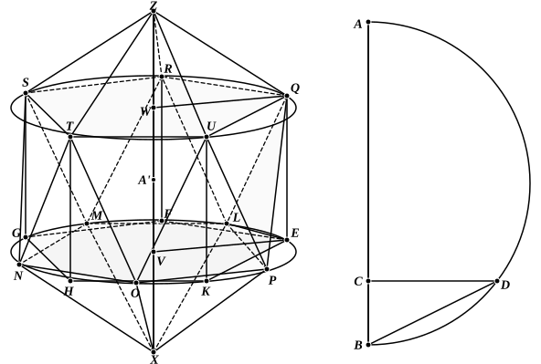

$BD$ *is the radius of the circular sections containing the pentagons.*  
[If $r$ is the radius of the sphere,  
since
$AB$ $:$ $BC$ $= $ $AB$$^2 : $ $AB$ $\cdot$ $BC$
$= $ $AB$$^2 : $ $BD$$^2$,
while
$AB$ $= 5$$BC$,
it follows that
$AB$$^2 = 5$$BD$$^2$,
or
$$\text{(radius of section)}^2 = \frac{4}{5} r^2.$$
Thus [XIII. 10, note] $\text{(side of pentagon)}^2 = \frac{r^2}{5} (10 - 2\sqrt{5})$.]

Inscribe the regular pentagon ">$EFGHK$ in the circle $EFGHK$ of radius equal to $BD$.  
Bisect the arcs $EF$, $FG$, ..., so forming a decagon in the circle.  
Joining successive points of bisection, we obtain another regular pentagon ">$LMNOP$.  
">$LMNOP$ *is one of the pentagons containing five edges of the icosahedron.*  
The other circle and inscribed pentagon are obtained by drawing perpendiculars from $E$, $F$, $G$, $H$, $K$ to the plane of the circle, as $EQ$, $FR$, $GS$, $HT$, $KU$, and making each of these perpendiculars equal to the radius of the circle, or, as Euclid says, the side of the regular hexagon in it.  
">$QRSTU$ *is the second pentagon (of course equal to the first) containing five edges of the icosahedron.*  
Joining each angular point of one of the two pentagons to the two nearest angular points in the other pentagon, we complete ten triangles each of which has for one side a side of one or other of the two pentagons.  
$V$, $W$ are the centres of the two circles, and $VW$ is of course perpendicular to the planes of both.  
(2) *Produce* $VW$ *in both directions, making* $VX$ *and* $WZ$ *both equal to a side of the regular decagon in the circle (as* $EL$*).  
Joining $X$, $Z$ to the angular points of the corresponding pentagons, we
