Therefore
$$PQ = a.$$
Similarly it may be proved that every other edge is equal to $a$.
All the angular points lie on a sphere with radius $OP$, and
$$OP^2 = \frac{1}{4}(a^2 + l^2).$$

Each solid pentahedral angle is composed of five equal plane angles, each of which is the angle of an equilateral triangle.
Therefore the icosahedron is regular.
[$$a^2 = 4OP^2 - l^2.$$
And, from the equation $l^2 = la + a^2$, we derive
$$l = \frac{a}{2}(\sqrt{5} + 1).$$
Therefore, if $r$ be the radius of the sphere,
$$a^2 \left\{ 1 + \frac{(\sqrt{5} + 1)^2}{4} \right\} = 4r^2,$$
whence
$$\begin{aligned}
a &= 4r / \sqrt{10 + 2\sqrt{5}} \\
&= 4r \sqrt{10 - 2\sqrt{5}} / \sqrt{80} \\
&= \frac{r}{\sqrt{5}} \sqrt{10 - 2\sqrt{5}} \\
&= \frac{r}{5} \sqrt{10(5 - \sqrt{5})},
\end{aligned}$$
as above.]
