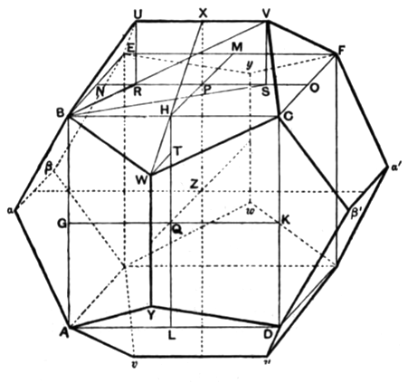

(4) that the vertex $U$ is on the sphere which circumscribes the cube, and hence
(5) that all the other vertices lie on the same sphere,
and (6) that the side of the dodecahedron is an *apotome*.

(1) To prove that the pentagon $BUVCW$ is equilateral.
We have
$$\begin{aligned}
BU^2 &= BR^2 + RU^2 \\
&= (BN^2 + NR^2) + RP^2 \\
&= (PN^2 + NR^2) + RP^2 \\
&= 3RP^2 + RP^2 \qquad\qquad\text{[XIII. 4]} \\
&= 4RP^2 \\
&= UV^2.
\end{aligned}$$
Therefore
$$BU = UV.$$

Similarly it may be proved that $BW$, $WC$, $CV$ are all equal to $UV$ or $BU$.

[Mr Taylor proceeds in this way. With his notation, the projections of $BU$ on $BA$, $BC$, $BE$ are respectively $\frac{1}{2}a$, $\frac{1}{2}(l - a)$, $\frac{1}{2}l$.
Therefore
$$\begin{aligned}
BU^2 &= \frac{1}{4}a^2 + \frac{1}{4}(l - a)^2 + \frac{1}{4}l^2 \\
&= \frac{1}{2}(l^2 - al + a^2) \\
&= a^2.
\end{aligned}$$
Similarly for $BW$, $WC$ etc.]

(2) To prove that the pentagon $BUVCW$ is in one plane.
Draw $PX$ parallel to $RU$ or $SV$ meeting $UV$ in $X$.
Join $XH$, $HW$.
