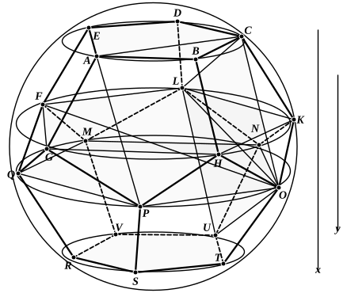

And the angle $OLF$ is right; for $PO$, $LF$ are equal and parallel chords in two equal and parallel circular sections of a sphere [Pappus' lemma, p. 138, 20–26].
Therefore
$OF$$^2 = $ $OL$$^2 + $ $FL$$^2 = 3$$FL$$^2$. [from above]
And $OF$ is a diameter of the sphere; for $PO$, $LF$ are on opposite sides of the centres of the circles in which they are [Pappus' lemma, pp. 136–8].

Now suppose $p$, $t$, $h$ to be the sides of an equilateral pentagon, triangle and hexagon in the circle $FGHKL$, $d$ the diameter of the sphere.
Then
$d : $ $FL$ $= \sqrt{3} : 1$ [from above]
$$= t : h; \qquad \text{[Eucl. XIII. 12]}$$
and it follows *alternando* (since $FL$ $= p$) that
$$d : t = p : h.$$
Now let $d'$, $p'$, $h'$ be the sides of a regular decagon, pentagon and hexagon respectively inscribed in *any one* circle.
Since, if $FL$ be divided in extreme and mean ratio, the greater segment is equal to $ED$, [XIII. 8]
$FL$ $:$ $ED$ $= h' : d'$. [VI. Def. 3, XIII. 9]
And $FL$ $:$ $ED$ is the ratio of the sides of the regular pentagons inscribed in the circles $FGHKL$, $ABCDE$, and is therefore equal to the ratio of the sides of the equilateral triangles inscribed in the same circles.
Therefore
$t : (\text{side of }\triangle\text{ in }$ $ABCDE$$) = h' : d'$.
But
$$\begin{aligned}
d : t &= p : h \\
&= p' : h';
\end{aligned}$$
therefore, *ex aequali*, $d : (\text{side of }\triangle\text{ in }$ $ABCDE$$) = p' : d'$.
Now $d$ is given;
therefore the sides of the equilateral triangles inscribed in the circles $ABCDE$, $FGHKL$ respectively are given, whence the radii of those circles are also given.
